# 🇺🇦 Oko

[🇺🇦 Українська](#українська) · [🇬🇧 English](#english)

---

## Українська

**Жива карта повітряної загрози для України — бач, що летить, куди воно прямує і коли ховатися.**

Без акаунта. Без трекера. Без нашого хмару. Лише картина загрози — просто з першоджерела, на мапі, яка лишається читабельною тоді, коли це найважливіше.

  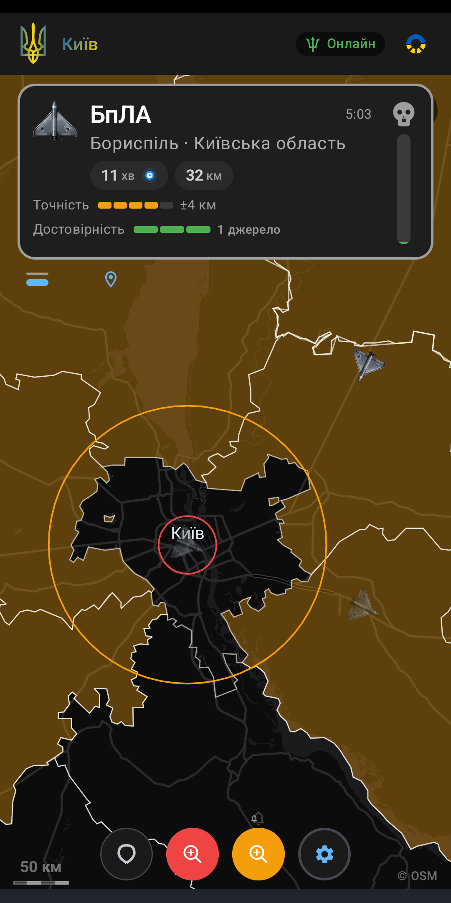
  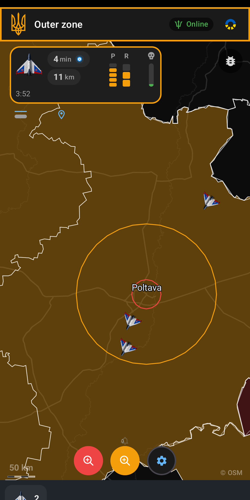
  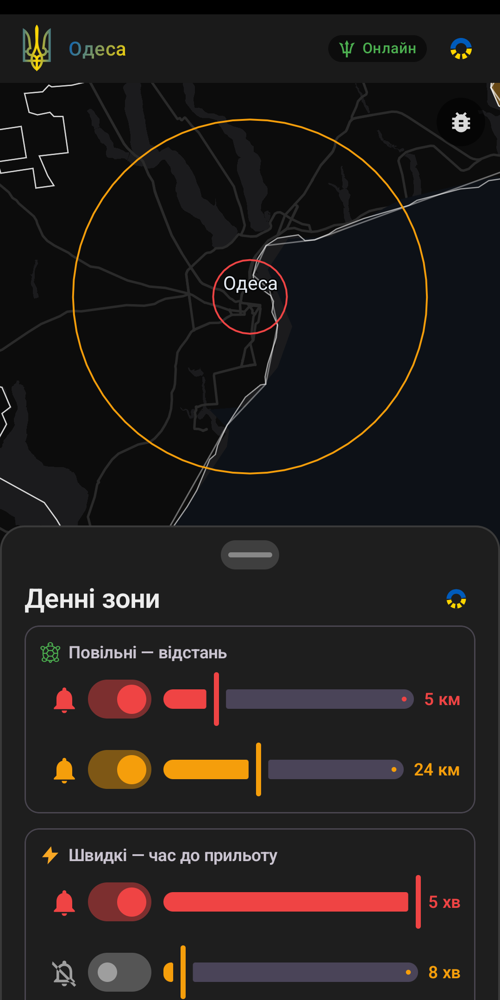
   
  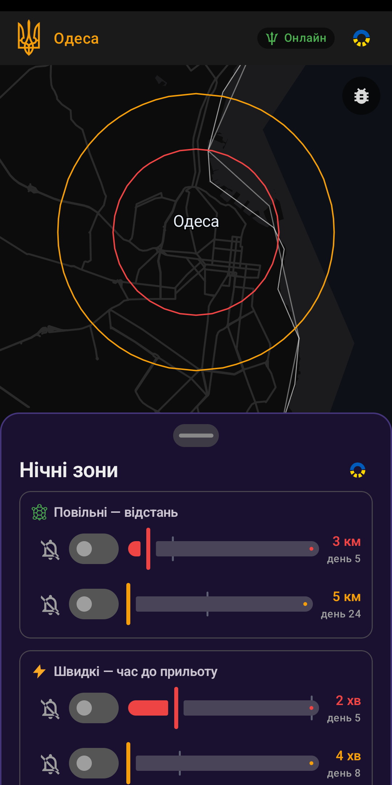
  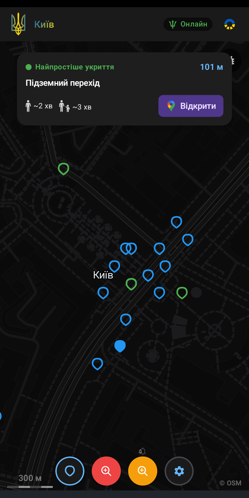
  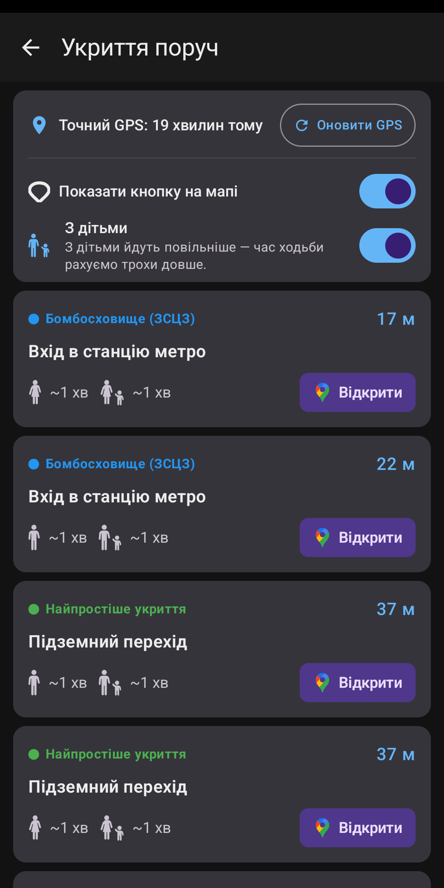

### Що ти отримуєш

- 🗺️ **Жива мапа неба** — ворожі цілі надходять потоком і рухаються мапою в реальному часі.
- 🎯 **Рівні загрози та кільця зон** — одразу видно, що всередині твоїх внутрішнього і зовнішнього кілець.
- 🚨 **Офіційні тривоги та відбої** — стан сирени по регіонах, прив'язаний до міста чи області, які ти тримаєш.
- 🔴 **Червоні міста** — усі зони під активною тривогою, підсвічені по всій країні.
- 📍 **Відстань і час** — як далеко і як скоро вибрана загроза дістане твого району.
- 🔔 **Сповіщення** — тривога дійде, навіть коли застосунок закритий.
- 🌑 **Тільки темна тема** — високий контраст, легко для очей уночі та під час блекауту.

### 🎉 Бойовий дух — бо витривалість теж потребує підтримки

Дивитися в небо ніч за ніч важко. Тож застосунок трохи віддає назад. Вмикається чи вимикається в Налаштуваннях у розділі **Бойовий дух** — це суто прикраса, вона не торкається тривог чи зон.

- ✈️ **Проліт МіГ-31К** — коли МіГ-31К у повітрі, він проноситься твоєю мапою з анімацією, звуком і віддачею.
- 💥 **Збиття** — коли загроза зникає з ефіру, подивись, як вона йде. Кілька стилів анімації, опційна камера, що супроводжує снаряд до цілі, і детальніші HD-ефекти вибухів для кожного типу загрози.
- 🎯 **Лічильник знешкоджених** — поточний підрахунок того, що завершилося у твоєму регіоні. Натисни, щоб повторити все шоу, регіон за регіоном. Можна рахувати й усю Україну.
- 🔔 **Підсумок тривоги** — після завершення твоєї тривоги сповіщення розповість, що було знешкоджено за цей час. Натисни, щоб переглянути.
- 👋 **Перше вітання** — одноразовий «постріл» на честь першого запуску.
- 🤝 **Повага понад усе.** «Знешкоджено» означає лише те, що загроза зникла з ефіру — збита, впала або загубилася з радара; ми не можемо знати, що саме. Тому ми шануємо захисників і ніколи не святкуємо шкоду. А під час справжньої повітряної тривоги кожна з цих функцій **відступає.**

### Чому цьому можна довіряти

Це програмне забезпечення, пов'язане з безпекою, тож до його нутрощів вимоги вищі, ніж видно з інтерфейсу.

- **Одне джерело істини.** Мапа та фоновий сервіс тривог — незалежні читачі *того самого* обчислення; жодної другої копії логіки, яка могла б розійтися.
- **Справжній двигун, а не розкидані прапорці.** Стан загрози походить з одного двигуна з явними станами, а не з купи вільних булевих значень, розмазаних по інтерфейсу.
- **Детермінований і тестований.** Час завжди передається ззовні, а не читається з годинника всередині логіки, тож поведінку двигуна можна перевірити точно.
- **Письмовий контракт поведінки.** Правила двигуна живуть у [`BEHAVIORS.md`](BEHAVIORS.md), і код має їм відповідати — поведінка визначена, а не імпровізована.
- **Змінні джерела даних.** Застосунок працює з однією, незалежною від джерела моделлю загроз; потік даних — це змінний плагін за чистим інтерфейсом, тож новий потік не розповзається рештою застосунку.
- **Менше рухомих частин.** Без нашого бекенду, без Firebase, без push-інфраструктури — менше того, що може зламатися, і ніщо зайве не тримає твої дані.

### Отримати застосунок

- **Google Play** — основний реліз.
- **Бета / канал самооновлення** — найновіші збірки йдуть нашим власним каналом оновлень.

Дані надходять із публічного [NEPTUN](https://neptun.in.ua).

### Для розробників

Одномодульний Android-застосунок (`:app`) — Jetpack Compose (Material 3, тільки темна тема) + MapLibre, два флейвори збірки (`play` / `sideload`) з однієї кодової бази, потік через NEPTUN WebSocket без нашого бекенду.

- Мапа кодової бази та інваріанти → [`ARCHITECTURE.md`](ARCHITECTURE.md)
- Контракт двигуна загроз → [`BEHAVIORS.md`](BEHAVIORS.md)
- Релізний і робочий процес → [`AGENTS.md`](AGENTS.md)

### Ліцензія

GNU General Public License v3.0 only — див. [`LICENSE`](LICENSE). Флейвор `play` — ціль для збірки з джерел; `sideload` додає шлях самооновлення в застосунку.

---

## English

**A live air-threat map for Ukraine — see what's inbound, where it's heading, and when to take cover.**

No account. No tracker. No cloud of ours. Just the threat picture, straight from the source, on a map that stays readable when it matters most.

  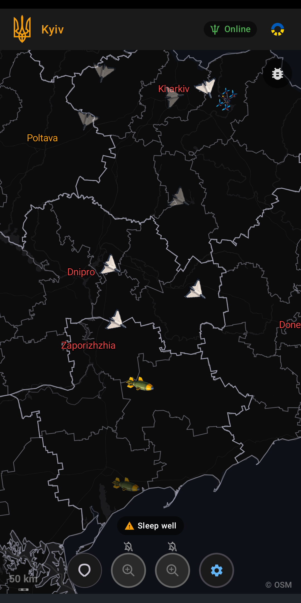
  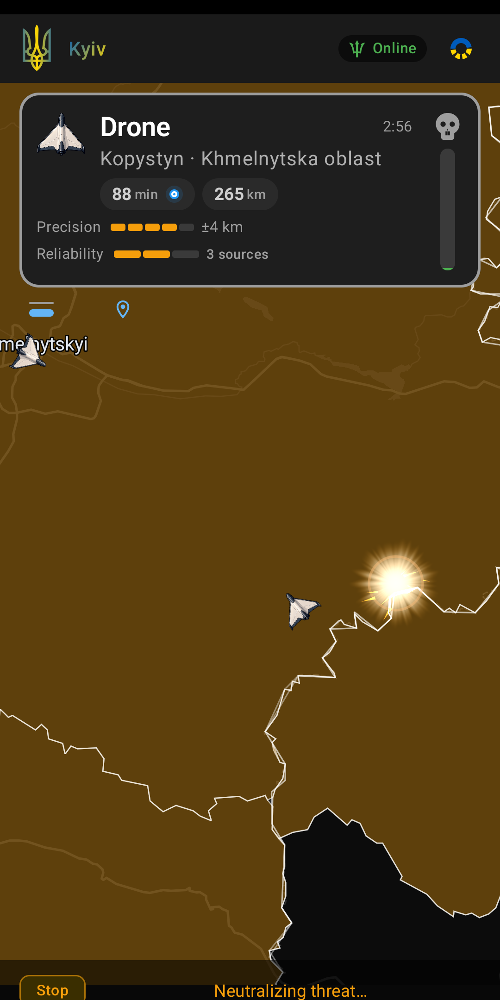
  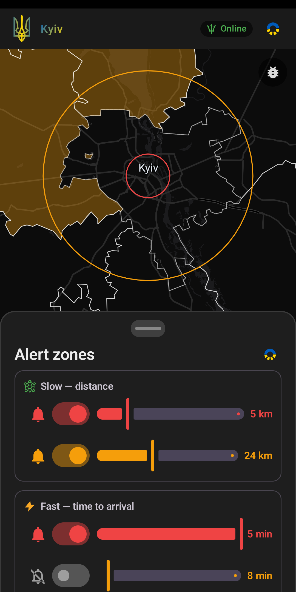
   
  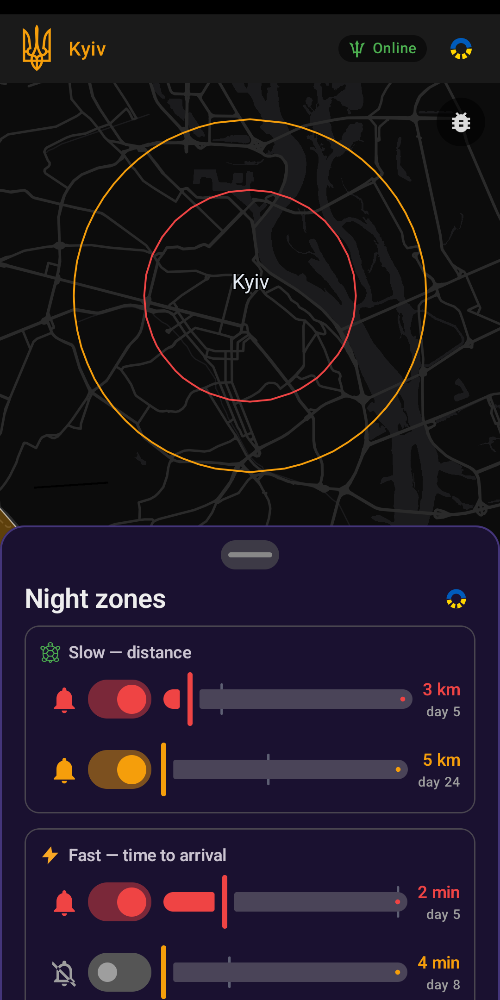
  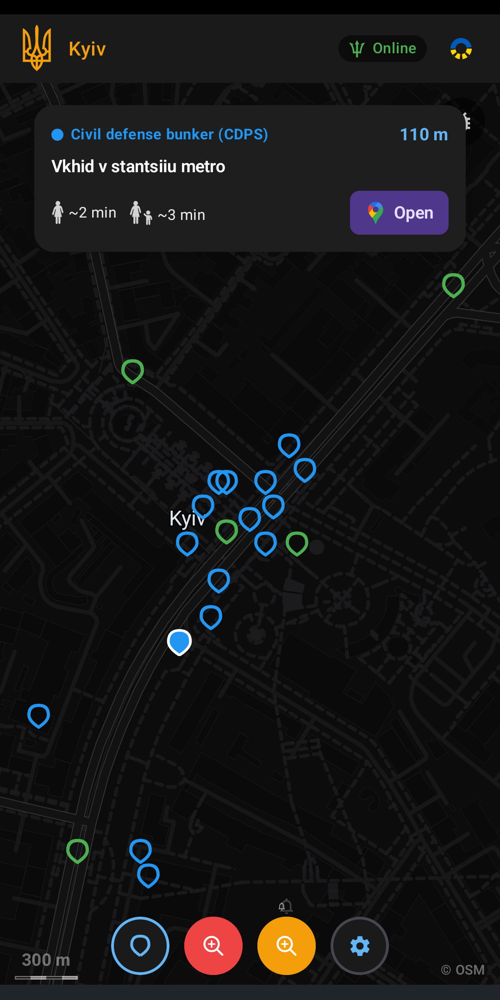
  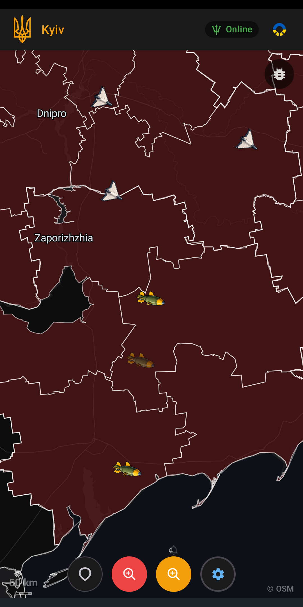

### What you get

- 🗺️ **A live map of the sky** — hostile tracks stream in and glide across the map in real time.
- 🎯 **Threat levels and zone rings** — instantly see what's inside your inner and outer rings.
- 🚨 **Official alerts and all-clears** — regional siren state, latched to the city or oblast you're watching.
- 🔴 **Red cities** — every area under active alert, lit up nationwide.
- 📍 **Distance and ETA** — how far, and how long until a selected threat reaches your area.
- 🔔 **Notifications** — alerts reach you even when the app isn't open.
- 🌑 **Dark-only by design** — high-contrast, easy on the eyes at night and in the blackout.

### 🎉 Morale — because endurance needs it too

Watching the sky night after night is heavy. So the app gives a little back. Off or on in Settings under **Morale** — pure decoration, it never touches alerts or zones.

- ✈️ **MiG-31K flyby** — when a MiG-31K is up, it roars across your map with animation, sound and haptics.
- 💥 **Shoot-downs** — when a threat leaves the feed, watch it go. Several animation styles, an optional camera that follows the bullet home, and richer HD explosion effects per threat type.
- 🎯 **Neutralized tally** — a running count of what's finished in your region. Tap it to replay the whole show, zooming region by region. Count all of Ukraine too, if you like.
- 🔔 **Air-raid summary** — after your alarm ends, a notification tells you what was neutralized while it lasted. Tap to watch it back.
- 👋 **A first hello** — a one-time welcome shot on your very first launch.
- 🤝 **Respect first.** "Neutralized" only means a threat left the feed — intercepted, crashed, or lost to radar; we can't know which. So we honor the defenders and never celebrate harm. And during a real air-raid alert, every one of these **steps aside.**

### Why it's built to be trusted

This is safety-relevant software, so the internals are held to a higher bar than the UI lets on.

- **One source of truth.** The map and the background alert service are independent readers of the *same* evaluation — no second copy of the logic that can drift out of sync.
- **A real engine, not scattered flags.** Threat state comes from one evaluation engine with explicit states, never a pile of loose booleans smeared across the UI.
- **Deterministic and testable.** Time is always passed in, never read from the wall clock inside the logic, so the engine's behavior can be verified exactly.
- **A written behavioral contract.** The engine's rules live in [`BEHAVIORS.md`](BEHAVIORS.md) and the code is expected to match it — behavior is specified, not improvised.
- **Plug-in data sources.** The app talks to one source-agnostic threat model; the data feed is a swappable plug-in behind a clean interface, so a new stream can't ripple through the rest of the app.
- **Fewer moving parts.** No backend of ours, no Firebase, no push infrastructure — fewer things that can break, and nothing extra holding your data.

### Get the app

- **Google Play** — the primary release.
- **Beta / self-updating feed** — the latest builds ship through our own update channel.

Data comes from the public [NEPTUN](https://neptun.in.ua) feed.

### For developers

Single-module Android app (`:app`) — Jetpack Compose (Material 3, dark-only) + MapLibre, two build flavors (`play` / `sideload`) from one codebase, streaming the NEPTUN WebSocket with no backend of ours.

- Codebase map and invariants → [`ARCHITECTURE.md`](ARCHITECTURE.md)
- Threat-engine contract → [`BEHAVIORS.md`](BEHAVIORS.md)
- Release and dev workflow → [`AGENTS.md`](AGENTS.md)

### License

GNU General Public License v3.0 only — see [`LICENSE`](LICENSE). The `play` flavor is the source-build target; `sideload` adds the in-app self-update path.
